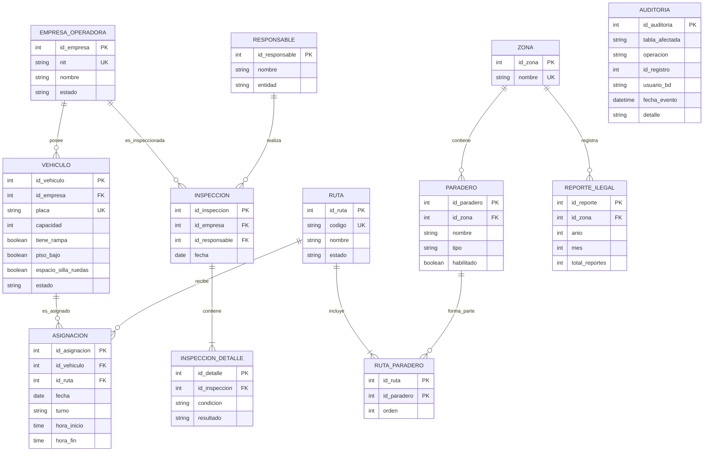

# E3 · Diagrama conceptual

Proyecto Integrador Final · P11 Transporte público y mototaxismo (SETP Santa Marta)

## Especificación textual en notación Chen

Cardinalidades en la forma **(mínimo, máximo)** al lado de cada entidad. Los atributos marcados *(ID)* identifican a la entidad.

| Relación (rombo) | Entidad A | (min,max) A | Entidad B | (min,max) B | Atributos de la relación |
|---|---|---|---|---|---|
| POSEE | EMPRESA_OPERADORA | (0,N) | VEHICULO | (1,1) | — |
| SE_ASIGNA | VEHICULO | (0,N) | ASIGNACION | (1,1) | — |
| RECIBE | RUTA | (0,N) | ASIGNACION | (1,1) | — |
| INCLUYE | RUTA | (0,N) | PARADERO | (0,N) | orden |
| UBICADO_EN | ZONA | (0,N) | PARADERO | (1,1) | — |
| REGISTRA | ZONA | (0,N) | REPORTE_ILEGAL | (1,1) | — |
| ES_INSPECCIONADA | EMPRESA_OPERADORA | (0,N) | INSPECCION | (1,1) | — |
| REALIZA | RESPONSABLE | (0,N) | INSPECCION | (1,1) | — |
| CONTIENE (identificadora) | INSPECCION | (1,3)* | INSPECCION_DETALLE (débil) | (1,1) | — |

\* Intención de negocio: una inspección evalúa de 1 a 3 condiciones. **El DDL no impone el mínimo de 1**; es una limitación conocida.

**Entidades y atributos.**
EMPRESA_OPERADORA(nit *(ID)*, nombre, estado) · VEHICULO(placa *(ID)*, capacidad, tiene_rampa, piso_bajo, espacio_silla_ruedas, estado) · ZONA(nombre *(ID)*) · PARADERO(nombre, tipo, habilitado) · RUTA(codigo *(ID)*, nombre, estado) · ASIGNACION(fecha, turno, hora_inicio, hora_fin; identificada por vehículo + fecha + turno) · RESPONSABLE(nombre, entidad) · INSPECCION(fecha) · INSPECCION_DETALLE(condicion, resultado; identificada por inspección + condición) · REPORTE_ILEGAL(anio, mes, total_reportes; identificada por zona + año + mes).

**Participación total:** ASIGNACION, PARADERO, REPORTE_ILEGAL, INSPECCION, INSPECCION_DETALLE y VEHICULO dependen de su entidad padre (cardinalidad mínima 1 en ese lado).

## REPRESENTACIÓN APROXIMADA EN PATA DE CUERVO — NO ES CHEN

El siguiente código Mermaid (`erDiagram`) muestra el modelo con pata de cuervo y claves. Para exportarlo, péguelo en mermaid.live.

*Estado:* REVISADO ESTÁTICAMENTE. La imagen exportada (`docs/er.png`) debe guardarse como evidencia.
